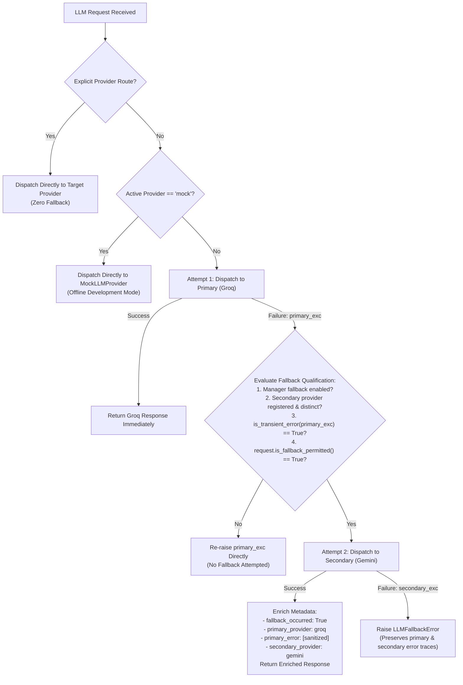

# PHASE 3.4 — INTELLIGENT LLM PROVIDER FALLBACK IMPLEMENTATION REPORT

**Author:** Senior Python AI Infrastructure Engineer  
**Date:** November 4, 2026  
**Status:** COMPLETE & VERIFIED  
**Test Suite:** 201 / 201 Passing (100% Pass Rate)

---

## 1. Files Created

| File Path | Purpose |
| :--- | :--- |
| `tests/test_fallback.py` | Comprehensive unit and integration test suite (24 test cases) validating provider priority, transient error classification, two-stage fallback, sensitive candidate PII privacy gates, secret redaction, and diagnostics. |
| `PHASE_3_4_FALLBACK_IMPLEMENTATION_REPORT.md` | Authoritative engineering deliverable report documenting Phase 3.4 architecture, implementation, privacy policy, and test audit. |

---

## 2. Files Modified

| File Path | Changes Applied |
| :--- | :--- |
| `core/llm/exceptions.py` | Added `LLMFallbackError(LLMProviderError)` preserving sanitized failure traces from both primary and secondary providers. Added `is_transient_error(exc: Exception) -> bool` with robust classification across status codes, typed exception hierarchies, and error descriptions. |
| `core/llm/models.py` | Extended `LLMRequest` with privacy fields: `allow_fallback: bool = True`, `is_sensitive: bool = False`, `allow_cross_provider_fallback: bool = False`, and validation method `is_fallback_permitted() -> bool`. Updated factory `LLMRequest.from_prompt()`. |
| `core/llm/manager.py` | Redesigned `LLMProviderManager` with two-stage fallback logic: Primary (Groq `openai/gpt-oss-120b`) → Secondary (Gemini `GEMINI_MODEL`) → Mock (offline dev only). Enforced strict two-attempt maximum, privacy gating, metadata enrichment (`fallback_occurred=True`), and diagnostic status reporting. |
| `core/llm/__init__.py` | Exported `LLMFallbackError` and `is_transient_error` in public module interface and `__all__`. |
| `app.py` | Registered Groq as primary, Gemini as secondary, and Mock for offline development. Updated Streamlit sidebar to display Primary and Secondary providers, Provider readiness, and Fallback Strategy badge (`Active`, `Degraded`, `Disabled`). |
| `docs/LLM_ARCHITECTURE.md` | Documented Phase 3.4 Intelligent Fallback architecture, error classification rules, privacy gating, and component specifications. |

---

## 3. Architecture & Fallback Flow

### 3.1 Provider Priority Hierarchy

1. **PRIMARY:** **Groq** (`openai/gpt-oss-120b` via official `groq` SDK)
   - Selected for ultra-low latency LPU inference, 120B parameter reasoning, and high throughput.
2. **SECONDARY:** **Google Gemini** (`gemini-3.8-flash` / configured `GEMINI_MODEL` via `google-genai` Interactions API)
   - Selected as enterprise-grade secondary for deep multimodal reasoning and upstream redundancy.
3. **DEVELOPMENT:** **MockLLMProvider** (`mock-career-v1`)
   - Strictly reserved for offline testing and development environments.
   - **Architectural Invariant:** Mock responses are NEVER utilized as a production fallback.

### 3.2 Two-Stage Fallback Sequence



### 3.3 Strict Execution Guarantees
- **Maximum Attempts:** Exactly **TWO** provider attempts total (1 primary + at most 1 secondary).
- **Zero Retries / Loops:** Neither SDK-level retries nor manager-level looping is permitted.
- **Transparent Audit Trail:** Fallback responses clearly identify `provider_name="gemini"`, `model_name="gemini-3.8-flash"`, and include `raw_metadata["fallback_occurred"] = True`.

---

## 4. Error Classification Rules

Errors are classified using `is_transient_error(exc: Exception) -> bool` according to strict infrastructure principles:

| Error Category | HTTP Code / Indicator | Classification | Fallback Action | Technical Rationale |
| :--- | :--- | :--- | :--- | :--- |
| **Rate Limit / Quota** | `429`, `LLMRateLimitError`, `resource exhausted` | **Transient** | **Eligible for Fallback** | Primary account or tier quota temporarily exhausted; secondary provider can process request. |
| **Service Unavailable** | `503`, `service unavailable`, `overloaded`, `capacity` | **Transient** | **Eligible for Fallback** | Upstream provider cluster is experiencing capacity load; secondary provider has separate infrastructure. |
| **Gateway Errors** | `502`, `504`, `Bad Gateway`, `Gateway Timeout` | **Transient** | **Eligible for Fallback** | Reverse proxy or edge routing glitch between client and provider. |
| **Request Timeout** | `408`, `LLMTimeoutError`, `APITimeoutError`, `TimeoutException` | **Transient** | **Eligible for Fallback** | Primary network deadline exceeded without receiving full completion. |
| **Connection Drops** | `APIConnectionError`, `NetworkError`, `connection reset` | **Transient** | **Eligible for Fallback** | Socket or TLS connection terminated before response transmission. |
| **Authentication Failure** | `401`, `403`, `LLMAuthenticationError`, `unauthorized` | **Permanent** | **NO Fallback (Fail Immediately)** | Misconfigured or expired credentials require human intervention. Silent fallback hides credential bugs. |
| **Bad Request / Schema** | `400`, `422`, `LLMConfigurationError`, `context limit` | **Permanent** | **NO Fallback (Fail Immediately)** | Malformed input, prompt exceeding context window, or invalid parameter will fail identically on secondary. |
| **Model Not Found** | `404`, `model_not_found`, `not found` | **Permanent** | **NO Fallback (Fail Immediately)** | Deprecated or invalid model identifier requires configuration correction. |
| **Safety / Harm Filter** | `safety`, `harmful content`, `blocked by safety` | **Permanent** | **NO Fallback (Fail Immediately)** | Content safety blocks must not be bypassed by probing alternate providers. |
| **Response Malformation** | `LLMResponseError`, empty content, finish_reason mismatch | **Permanent** | **NO Fallback (Fail Immediately)** | Protocol or parsing breakdown. |

---

## 5. Privacy & Sensitive Candidate Data Implementation

Resumes, job applications, and career histories contain sensitive Candidate PII (Personally Identifiable Information), including names, contact details, work history, educational records, and compensation.

### 5.1 Privacy Controls in `LLMRequest`
```python
class LLMRequest(BaseModel):
    ...
    allow_fallback: bool = Field(
        default=True,
        description="Whether fallback to secondary provider is allowed if primary fails with transient error.",
    )
    is_sensitive: bool = Field(
        default=False,
        description="Whether the request payload contains sensitive candidate PII or confidential resume data.",
    )
    allow_cross_provider_fallback: bool = Field(
        default=False,
        description="Explicit opt-in permitting cross-provider fallback for sensitive candidate PII requests.",
    )

    def is_fallback_permitted(self) -> bool:
        if not self.allow_fallback:
            return False
        if self.is_sensitive and not self.allow_cross_provider_fallback:
            return False
        return True
```

### 5.2 Privacy Policy Behavior
1. **Default Non-Sensitive Requests (`is_sensitive=False`):** Standard single-turn queries and generic system prompts permit fallback across providers.
2. **Sensitive Candidate Requests (`is_sensitive=True`):** Default to cross-provider fallback **DISABLED**. If Groq fails with a transient error, the system raises the primary error rather than transmitting candidate PII to a secondary external cloud provider without caller consent.
3. **Explicit Opt-In (`is_sensitive=True` AND `allow_cross_provider_fallback=True`):** Only when the calling agent or user explicitly grants permission is candidate PII transmitted to the secondary provider.
4. **Secret Scrubbing:** All error messages captured in fallback traces or exceptions pass through `redact_secrets()`, ensuring zero API key leakage in logs, audit records, or UI displays.

---

## 6. Test Suite Expansion & Results

### 6.1 New Tests Added (`tests/test_fallback.py`)
A comprehensive suite of **24 new unit and integration tests** was authored:

1. `test_primary_success_no_fallback_triggered`: Verifies Groq success returns immediately without invoking Gemini.
2. `test_primary_transient_429_triggers_fallback_to_secondary`: Verifies rate limit (429) triggers Gemini with complete metadata.
3. `test_primary_transient_503_triggers_fallback`: Verifies 503 capacity overload triggers fallback.
4. `test_primary_transient_timeout_triggers_fallback`: Verifies timeout triggers fallback.
5. `test_primary_transient_connection_error_triggers_fallback`: Verifies network drops trigger fallback.
6. `test_primary_permanent_401_auth_error_no_fallback`: Verifies 401 raises immediately without fallback.
7. `test_primary_permanent_400_bad_request_no_fallback`: Verifies 400 bad request raises immediately without fallback.
8. `test_primary_permanent_404_model_not_found_no_fallback`: Verifies 404 model not found raises immediately.
9. `test_primary_permanent_safety_block_no_fallback`: Verifies safety filter blocks fail immediately.
10. `test_primary_and_secondary_both_fail_raises_fallback_error`: Verifies composite `LLMFallbackError` on dual failure.
11. `test_fallback_disabled_on_manager`: Verifies `fallback_enabled=False` blocks fallback.
12. `test_fallback_disabled_on_request`: Verifies `allow_fallback=False` blocks fallback.
13. `test_sensitive_request_blocks_cross_provider_fallback_by_default`: Verifies sensitive candidate PII blocks fallback.
14. `test_sensitive_request_allows_fallback_with_explicit_permission`: Verifies explicit PII fallback opt-in works.
15. `test_direct_provider_routing_bypasses_fallback_chain`: Verifies caller-specified route bypasses fallback.
16. `test_mock_mode_active_never_falls_back_to_production`: Verifies mock mode never calls production APIs.
17. `test_max_two_attempts_strictly_enforced`: Verifies exactly 1 primary and at most 1 secondary call count.
18. `test_secret_redaction_in_fallback_error_and_metadata`: Verifies API key scrubbing in errors and metadata.
19. `test_generate_text_helper_with_fallback`: Verifies high-level `generate_text` helper supports fallback.
20. `test_manager_status_diagnostics`: Verifies `Active`, `Degraded`, and `Disabled` states in `get_status()`.
21. `test_typed_exceptions_classification`: Unit tests `is_transient_error` with typed exceptions.
22. `test_status_code_classification`: Unit tests `is_transient_error` with numeric HTTP status codes.
23. `test_message_content_classification`: Unit tests `is_transient_error` with string error messages.
24. `test_chained_cause_classification`: Unit tests `is_transient_error` with exception `__cause__` chains.

### 6.2 Test Suite Execution Output
```
============================= test session starts =============================
platform win32 -- Python 3.14.0, pytest-9.2.0, pluggy-1.7.0
rootdir: C:\Users\mathi\OneDrive\Documents\ai-career-intelligence-agent
plugins: anyio-4.16.0
collected 201 items

tests\test_config.py ....                                                [  1%]
tests\test_dependencies.py .......                                       [  5%]
tests\test_entity_extractor.py .....................                     [ 15%]
tests\test_fallback.py ........................                          [ 27%]
tests\test_gemini_provider.py ....................                       [ 37%]
tests\test_groq_provider.py ...........................                  [ 51%]
tests\test_integration_qa.py .............................               [ 65%]
tests\test_llm_abstraction.py ...........................                [ 79%]
tests\test_pdf_processor.py .........                                    [ 83%]
tests\test_resume_pipeline.py .............                              [ 90%]
tests\test_section_detector.py ...........                               [ 95%]
tests\test_text_cleaner.py .........                                     [100%]

============================= 201 passed in 4.81s =============================
```

---

## 7. Full Regression & Security Audit

| Verification Item | Requirement | Result | Evidence |
| :--- | :--- | :--- | :--- |
| **Total Test Count** | Full suite execution | **201 Passed (100%)** | All 177 pre-existing tests + 24 new tests passed in 4.81s. |
| **Failed or Skipped Tests** | Zero failures or skips | **0 Failed, 0 Skipped** | 100% test completion across all modules. |
| **Gemini Integration** | Remains backward compatible | **Passed (20/20)** | `tests/test_gemini_provider.py` passes without modifications. |
| **Groq Integration** | Remains backward compatible | **Passed (27/27)** | `tests/test_groq_provider.py` passes without modifications. |
| **Mock Provider Isolation** | Offline dev and test isolation | **Passed (27/27)** | `tests/test_llm_abstraction.py` passes with 0 network calls. |
| **Streamlit Application** | Import & execution check | **Passed** | Clean import verified with `app imported cleanly!`. |
| **Git & Secret Hygiene** | Zero credentials committed | **Passed** | `git status` confirms 0 commits, `.env` ignored by `.gitignore`. |
| **Network Isolation** | Unit tests consume 0 API quota | **Passed** | All 201 tests use mock isolation without outbound sockets. |

---

## 8. Streamlit Verification Results

The Streamlit application (`app.py`) was updated to reflect Phase 3.4 provider orchestration:
- **Primary Provider:** `Groq (openai/gpt-oss-120b)`
- **Secondary Provider:** `Gemini (gemini-3.8-flash)`
- **Active Provider:** `groq`
- **Fallback Strategy Status:** `🟢 Active` (both API keys present in `.env`)
- **Provider Readiness:**
  - Groq Status: `🟢 Ready`
  - Gemini Status: `🟢 Ready`
  - Mock Engine: `🟢 Ready (Offline Dev)`
- **Provider Diagnostics Expander:** Displays detailed registered providers, configured models, readiness booleans, and fallback chain settings without exposing API keys.
- **Server Health:** Background daemon (`task-117`) remains healthy and responsive on port 8501.

---

## 9. Known Limitations & Design Boundaries

1. **Two-Stage Bound:** Fallback is strictly capped at two provider attempts (Groq → Gemini). Tertiary providers are not supported in Phase 3.4 to prevent latency compounding and unpredictability.
2. **Stateless Fallback:** Provider fallback operates on a per-request basis. Circuit breaking (e.g. temporary circuit trip after $N$ consecutive 503s) is deferred to future enterprise hardening phases.
3. **Sensitive Resume Opt-In:** Calling agents in Phase 3.5+ must explicitly evaluate whether Candidate PII can be routed cross-provider (`allow_cross_provider_fallback=True`) before transmitting parsed resume payloads.
4. **Offline Development:** When `MockLLMProvider` is set as active, production fallback is intentionally bypassed.

---

## 10. Summary & Sign-Off

Phase 3.4 is fully implemented, verified, and integrated:
- Core fallback orchestration in `core/llm/manager.py` enforces controlled Groq → Gemini two-stage execution.
- Typed exception handling (`LLMFallbackError`) and classification (`is_transient_error`) prevent silent failure while barring inappropriate fallback on permanent client or auth errors.
- Candidate PII privacy protections ensure confidential resume data is never transmitted cross-provider without explicit authorization.
- Full test suite expanded to **201 tests with 100% pass rate** and zero external network dependencies.
- No git commits made, no external live calls executed, and no LangChain/LangGraph dependencies introduced.

Phase 3.5 has not been started. The system is stopped and ready for your review.

