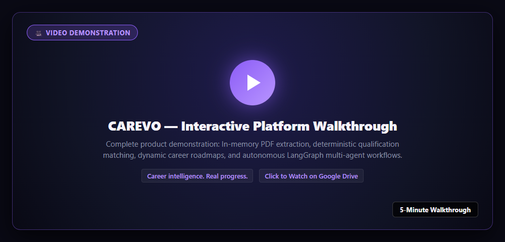
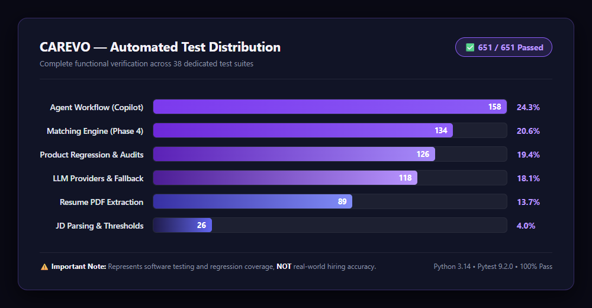
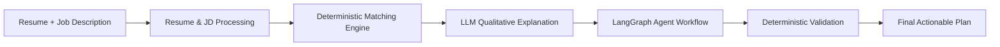
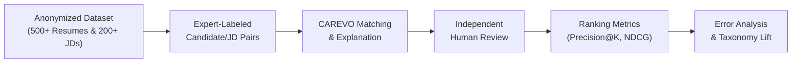
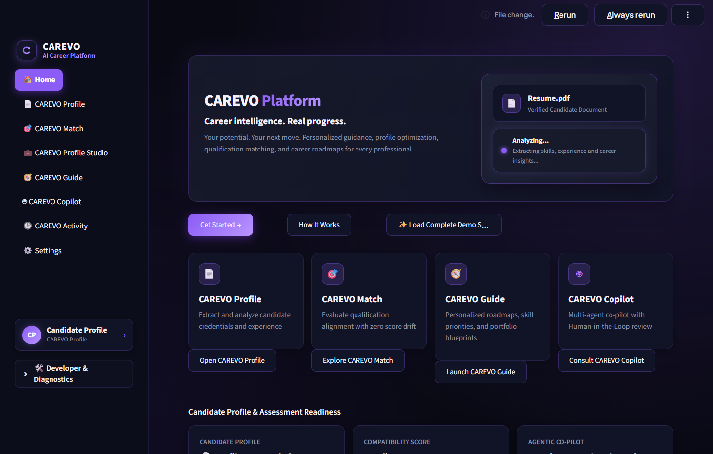
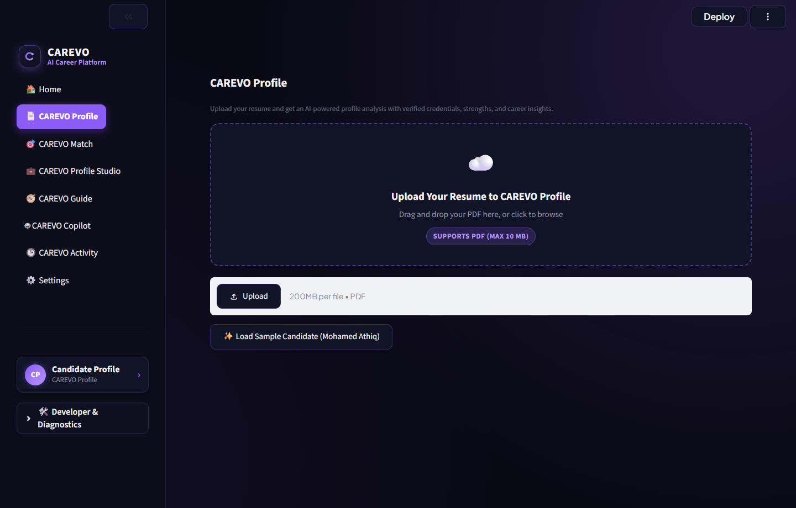
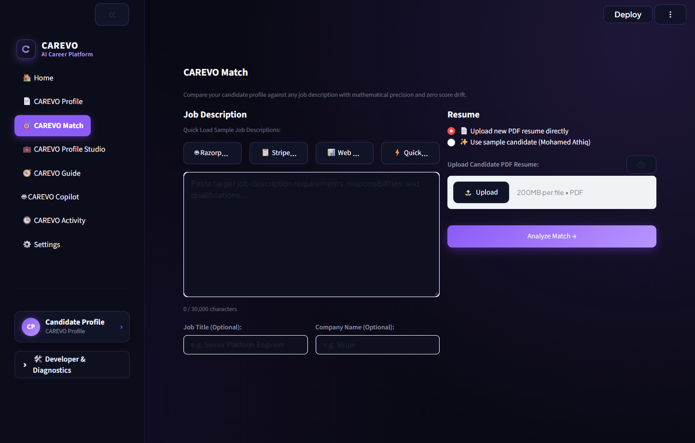
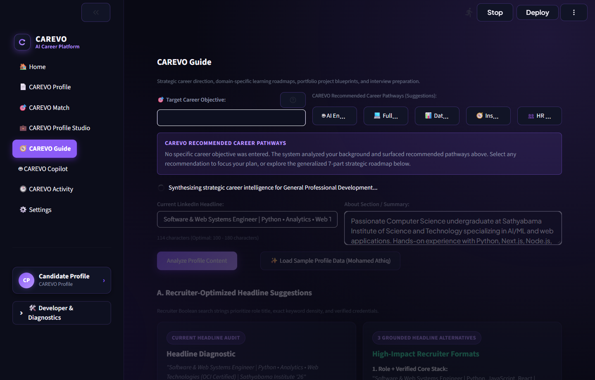
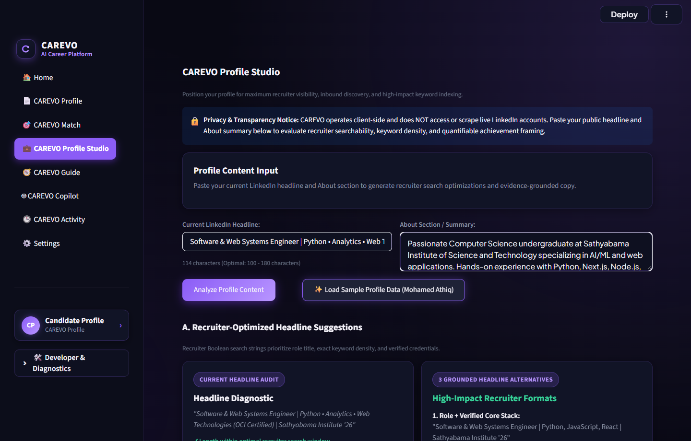
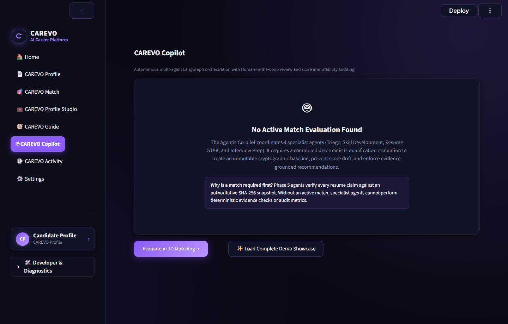

<p align="center">
  
</p>

<p align="center">
  <strong>Career intelligence. Real progress.</strong><br/>
  <em>Your potential. Your next move.</em>
</p>

<p align="center">
  
  
  
  
  
</p>

---

## What is CAREVO?

CAREVO helps students, graduates, professionals and career changers understand their qualifications, evaluate job opportunities, identify skill gaps and plan their next career move using AI.

Unlike generic career bots that generate ungrounded praise or hallucinated ratings, CAREVO evaluates real candidate evidence, enforces mathematical anti-inflation scoring, and coordinates specialized agents with human-in-the-loop review. It is built for both **technical disciplines** (software engineering, data analytics, cloud) and **non-technical professions** (mortgage lending, insurance, real estate consulting, human resources, finance, and operations).

---

## 🎥 Project Demo — 5-Minute Walkthrough

Watch a short demonstration of CAREVO, including resume analysis, job matching, personalized career guidance and AI-powered agent workflows:

<p align="center">
  <a href="https://drive.google.com/drive/folders/1mDp85tE53p_ldbEG9pjeEyhezURaYNaJ?usp=sharing" target="_blank">
    
  </a>
</p>

> 🔗 **Direct Demo Link:** [Watch the Full 5-Minute Walkthrough on Google Drive](https://drive.google.com/drive/folders/1mDp85tE53p_ldbEG9pjeEyhezURaYNaJ?usp=sharing)

---

## 📊 Results & Verification

CAREVO treats evaluation rigor as a core engineering invariant. Every scoring formula, state transition, and privacy boundary is verified via reproducible automated test suites.

| Metric | Result | Benchmark Status |
|---|---|---|
| **Automated Test Suite** | **651 / 651 Passed (100%)** | 0 failures across 38 suites |
| **Optimized Bytecode Execution** | **651 / 651 Passed (100%)** | Verified under `python -O` (non-assert immutability) |
| **Score Immutability** | **100% Cryptographically Protected** | SHA-256 match fingerprint verified before & after agent steps |
| **Deterministic Consistency** | **100% Reproducible** | Identical inputs guarantee identical scores and weights |
| **Secret Redaction** | **Zero API Key Leakage** | Automated regex sanitization across all logs and error traces |

<p align="center">
  
</p>

### AI Workflow & Processing Flow



### ⚠️ Honest Disclosure on AI Matching Accuracy
> Passing 651 unit and integration tests verifies that the software adheres strictly to its formulas, state machines, and security invariants. It represents **software verification effort, not statistical hiring accuracy**.
> 
> CAREVO does not publish fabricated claims (such as "98.5% hiring prediction accuracy") because no universally accepted ground-truth dataset exists for candidate hiring success.

To establish statistical accuracy in future releases, CAREVO proposes this peer-reviewable framework:



---

## 🖥️ The Console

Walkthrough of CAREVO's interface using non-sensitive demonstration data.

### 1. Executive Dashboard
The home dashboard tracks real-time system status, candidate profile state, active job evaluation metrics, and developer telemetry.


### 2. CAREVO Profile (Resume Extraction)
Uploaded PDF resumes are processed entirely in memory via PyMuPDF. Contact information is scrubbed, canonical sections are detected, and skills, experience tenure, and STAR project achievements are structured into an immutable profile.


### 3. CAREVO Match (Deterministic Qualification Alignment)
Evaluates candidates against four core dimensions (Skills, Experience, Education, Projects). If an employer description omits criteria, the engine enforces strict **60% anti-inflation ceilings** rather than artificially inflating single-skill candidates to 100%. Sparse postings (< 3 technical skills or < 4 total requirements) trigger an amber **Provisional Evaluation** warning.


### 4. CAREVO Guide (Role-Aware Career Roadmaps)
Synthesizes a 7-part strategic career trajectory tailored to technical or non-technical archetypes (e.g., Senior Platform Engineer, Mortgage Lending, Insurance, Real Estate). Backed by live DuckDuckGo web research and labeled with transparent provenance badges (`AI-GENERATED` vs. `VERIFIED BASELINE`).


### 5. CAREVO Profile Studio (LinkedIn Optimization)
Analyzes public headline and About section copy client-side. Generates three alternative headline strategies (Role-focused, Specialization-focused, and Target-aspirational) and a complete structured About summary with verified technical skills and impact framing. No accounts are scraped or accessed.


### 6. CAREVO Copilot (LangGraph Multi-Agent Workflow)
Coordinates specialized AI agents (Triage, Remediation, Resume Optimization, Interview Prep). If a candidate's objective diverges from the target job posting, the workflow pauses to surface an interactive clarification prompt. Includes a **Human-in-the-Loop approval gate** before generating the consolidated plan.


---

## 🚀 Key Features

| Module | Feature | Problem Solved |
|---|---|---|
| **CAREVO Profile** | Resume Ingestion | In-memory PDF text extraction, canonical section detection, and structured entity extraction without persisting files to disk. |
| **CAREVO Match** | Qualification Matching | Multi-dimensional scoring with 60% anti-inflation caps, missing evidence tracking, and provisional evaluation safeguards. |
| **CAREVO Guide** | Strategic Guidance | 7-part career roadmaps, domain archetypes, transferable strengths, learning milestones, and live web research dossiers. |
| **CAREVO Profile Studio** | Recruiter Optimization | 3 headline alternatives, complete LinkedIn About section generation, and recruiter keyword density auditing. |
| **CAREVO Copilot** | Agentic Co-Pilot | LangGraph state graph with divergence triage, specialist sub-agents, SHA-256 score audit, and human approval checkpoints. |
| **CAREVO Interview** | Question Bank Generation | Contextual scenario and technical interview questions grounded in candidate qualification gaps. |
| **CAREVO Activity** | Telemetry & Observability | Live tracking of model invocations, provider latencies, web research calls, and fallback routing events. |

---

## ⚙️ How CAREVO Works

### The Core Architectural Principle
> **CAREVO separates numerical evaluation from AI-generated explanations.**

- **The Deterministic Engine** is the sole authority for compatibility scores. Python evaluates skills, experience tenure, and education credentials offline.
- **The LLM** explains the evidence, highlights gaps, and recommends improvements; it **cannot independently calculate or alter the numerical score**.
- **LangGraph** orchestrates specialized agents with typed state reducers and bounded self-correction cycles.
- **Human Approval Checkpoints** allow users to inspect deliverables, request changes, or approve the final synthesis.

```
┌────────────────────────────────────────────────────────────────────────┐
│                        CAREVO ARCHITECTURE                             │
│                                                                        │
│   Candidate PDF Stream ──► In-Memory Parser (PyMuPDF)                 │
│                        ──► Entity Extractor & Taxonomy Normalizer      │
│                        ──► Immutable ResumeProfile                     │
│                                     │                                  │
│   Target Job Posting   ──► Sanitizer & Threshold Counter               │
│                        ──► Immutable JobDescriptionProfile             │
│                                     │                                  │
│                                     ▼                                  │
│   DETERMINISTIC CORE   ──► 4 Sub-Evaluators (Skills, Exp, Edu, Proj)   │
│                        ──► WeightManager (60% Single-Dimension Cap)   │
│                        ──► Cryptographic SHA-256 Digest                │
│                                     │                                  │
│                                     ▼                                  │
│   AGENTIC COPILOT      ──► LangGraph StateGraph (MemorySaver)          │
│                        ──► Triage & Divergence Clarification           │
│                        ──► Specialist Agents (Remediation, STAR, Q&A)  │
│                        ──► Deterministic Audit (SHA-256 + PII Scanner) │
│                        ──► Human-in-the-Loop Checkpoint (Approval)     │
│                        ──► Synthesis Node & Consolidated JSON Report   │
└────────────────────────────────────────────────────────────────────────┘
```

---

## 🛠️ Technology Stack

- **Runtime:** Python 3.11, 3.12, 3.13, 3.14
- **Web Interface:** Streamlit (in-memory session state, reactive UI)
- **Agent Orchestration:** LangGraph 1.2.20 & LangGraph Checkpoint 4.3.1 (`StateGraph`, `MemorySaver`)
- **Document Processing:** PyMuPDF (`pymupdf` 1.24+) for stream parsing and character density OCR heuristics
- **Data Modeling:** Pydantic V2 (`frozen=True` immutable schemas)
- **Primary AI Provider:** Groq Cloud SDK (`openai/gpt-oss-120b`)
- **Secondary Fallback:** Google GenAI SDK (`gemini-3.8-flash` / `gemini-2.5-flash`)
- **Web Intelligence:** HTTPX with DuckDuckGo HTTP search (no API key required)
- **Testing:** Pytest (651 tests across 38 suites)

---

## 📦 Getting Started

### 1. Clone the Repository
```bash
git clone https://github.com/athiq14/carevo.git
cd carevo
```

### 2. Create and Activate Virtual Environment
```bash
python -m venv venv

# Windows (PowerShell):
.\venv\Scripts\Activate.ps1

# Windows (cmd.exe):
.\venv\Scripts\activate.bat

# macOS / Linux:
source venv/bin/activate
```

### 3. Install Dependencies
```bash
pip install -r requirements.txt
```

### 4. Configure Environment
```bash
# Windows (PowerShell):
Copy-Item .env.example .env

# macOS / Linux:
cp .env.example .env
```

Configure your API credentials in `.env`:
```ini
APP_ENV=development
APP_DEBUG=true

# Groq Cloud (Primary): https://console.groq.com/
GROQ_API_KEY=gsk_your_groq_api_key_here
GROQ_MODEL=openai/gpt-oss-120b

# Google Gemini (Secondary Fallback): https://aistudio.google.com/
GEMINI_API_KEY=AIzaSy_your_gemini_api_key_here
GEMINI_MODEL=gemini-3.8-flash
```

> 💡 **Offline Evaluation Mode:** If API keys are omitted, CAREVO operates automatically in **Rule-Based Fallback Mode**. All features, deterministic matching, and workflows remain fully testable without network access or API tokens.

### 5. Launch the Application
```bash
streamlit run app.py
```
Open **`http://localhost:8501`** in your browser.

### 6. Run the Test Suite
```bash
# Run all 651 automated tests
python -m pytest tests/ -v

# Run in optimized mode to verify score immutability
python -O -m pytest tests/ -q
```

---

## 📋 Limitations & Roadmap

### Current Limitations
- **Scanned PDFs:** Purely image-based PDFs lacking a text layer are flagged with `requires_ocr=True`; local image OCR (e.g. Tesseract) is not yet integrated.
- **In-Memory Checkpoints:** LangGraph workflow sessions use in-memory `MemorySaver` and do not persist across Streamlit server restarts.
- **Ground-Truth Benchmarks:** While mathematical reproducibility is 100%, empirical hiring prediction accuracy has not yet been established against an external labelled dataset.

### Planned Improvements
- [ ] Assemble an open 1,000-sample resume-to-JD paired dataset with hiring manager ground-truth annotations.
- [ ] PostgreSQL persistent checkpointer backend (`langgraph-checkpoint-postgres`).
- [ ] Optional local Tesseract OCR worker for image-only resumes.
- [ ] Hybrid matching combining deterministic taxonomy rules with local embedding similarity.

---

## 👤 Author

**Mohamed Athiq M**  
- **GitHub:** [@athiq14](https://github.com/athiq14)  
- **LinkedIn:** [linkedin.com/in/athiq14](https://www.linkedin.com/in/athiq14/)  
- **Repository:** [https://github.com/athiq14/carevo](https://github.com/athiq14/carevo)

---

## 📄 License
Licensed under the [Apache License 2.0](LICENSE).
